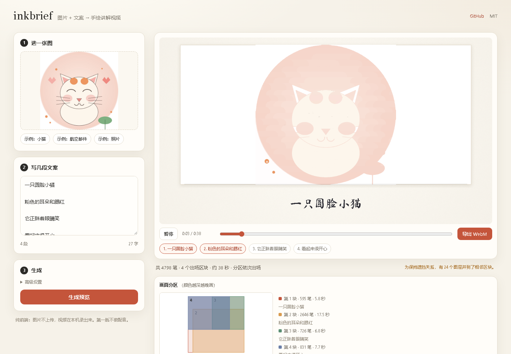

# inkbrief

**一张图 + 几段文案 → 一支手绘讲解视频。** 全在浏览器里跑，图片不上传，导出一支带手写字幕的 WebM。



## 它是什么

你把一张图丢进网页，再粘贴几段文案（空行分段）。它会：

1. 把图拆成"图层"，按遮挡关系分成几块；
2. 一块一块地画出来——先底色/背景，再主体，最后细节；
3. 每画一块，下方用**手写体**把对应那段话一个字一个字写出来；
4. 整张图画完，导出 1280×720 的 WebM。

第一版不做配音、不做 MP4、不做手动调笔。目标是把"讲到哪、画到哪"这件事先做顺。

## 快速开始

纯静态，无构建、无依赖：

```bash
cd inkbrief
python -m http.server 8000
# 打开 http://127.0.0.1:8000/
```

用 Chrome / Edge。页面里有三张示例：小猫（插画）、航空邮件（海报）、照片（会退化成整图播放）。

## 怎么用

1. **选图**：点选或拖入一张图。长边会缩到 1024，图片只在本机内存里处理。
2. **写文案**：用**空行**分段，一段对应画面的一块。最多 8 段。
3. **生成**：等 10~40 秒提炼笔触，然后自动开播。
4. **导出**：点"导出 WebM"。导出是实时录制，视频多长就要等多久；请保持标签页在前台。

## 它是怎么画的

- 笔触引擎来自 [image2strokes](https://github.com/longguanhong0755/image2strokes)（MIT）。它把图拆成图层、按"被压住的先画"排序，每一笔是纯色 + 裁剪掩膜。
- **管线只跑一次**。之后只改"什么时候画"：把图层按位置聚成 K 块（K = 文案段数），背景固定第 1 块，再把笔按"块号 + 原笔号"重排。
- **重排不改变最终画面**：只要两支笔的裁剪掩膜可能重叠，它们在重排后仍保持原来的先后，最终帧就与不重排时逐像素一致。`dev/order_check.mjs` 就是查这个的（逆序数必须为 0）。
- 时间轴：每块时长取"读完这段字"和"画完这组笔"的较大者；每笔时间按轨迹长度和阶段分配。
- 字幕：Ma Shan Zheng（SIL OFL 1.1），逐字揭示，字号 46→24 自适应，最多 2~3 行。
- 合成：1280×720 纸面 + 图画框 + 字幕 + 笔尖；导出用 `MediaRecorder` 录合成画布。

## 离线验收

不需要网页，Node 直接跑：

```bash
node dev/regress.mjs        # 三张 fixture 的基线：笔数/模式/景数/时长/逆序
node dev/order_check.mjs    # 硬门禁：所有可能重叠的笔对，逆序必须 = 0
node dev/timeline_check.mjs # 时间轴单调、字幕窗口、frameAt
node dev/subtitle_layout.mjs# 换行/字号/标点/溢出/英文/空串
node dev/scene_map.mjs      # 输出 dev/out/scene-*.bmp + .json，肉眼看分区
```

`dev/regress.mjs --save` 会更新基线。fixture 是 `dev/fixtures/*.raw`（512px，来自 image2strokes 的 CC0 / 公有领域样图）。

### 浏览器端到端（可选）

需要本机 Chrome + `playwright-core`（不是项目依赖，不会打包进网站）：

```bash
# 任选一个目录安装 playwright-core
npm install playwright-core

PLAYWRIGHT_CORE=/path/to/node_modules/playwright-core \
  node dev/browser_test.mjs
```

它会真的点示例、生成、暂停/恢复、拖动、场景跳转、取消导出、完整导出、照片退化、字体失败降级、空输入、非图片、9 段、移动端溢出，并做一次"场景序 vs 原序"的最终帧逐像素比较。

## 已知限制

- **没有配音/BGM**，也没有 MP4/GIF；只导出 WebM。
- **导出是实时录制**：38 秒的视频要等约 38 秒；慢机会掉帧（不会把视频拉长），后台标签页会自动暂停。
- **照片类会退化成整图播放**：图层互相压得太密、分不出干净区域时，程序不硬分区，只让字幕按段换。1024px 照片笔数可能到 3 万，时长会顶到 150 秒上限；建议把"细节"调成"快"。
- **方形图在 16:9 画框里左右留白**：图片按 contain 放进 1120×540，不裁切；这是有意的。
- **最后一块可能很长**：精细区域（海报的文字/纹理）会把大量补笔集中到最后一块，观感是"最后统一修细节"。
- **不能手动调分区/笔序**：第一版只自动分；文案段数少于画面可分数时，多段字幕会按比例放进同一块。
- **字体会回退**：字体 WOFF2 3.2MB（TTF 5.9MB 兜底），慢网会先用系统楷体，字体在后台加载完会自动换回手写体；如果一直加载不到就保持楷体。
- **WebM 时长元数据**：Chrome 录出的 WebM 有时不写 Duration，部分播放器显示 Infinity，不影响播放。

## 目录

```
index.html              页面
css/app.css             样式
js/main.js              UI / 生成 / 回放 / 导出
js/worker.js            Worker 入口
js/core/scene-planner.js  图层 → 场景 + 顺序约束
js/core/order-check.js    逆序门禁
js/core/timeline.js       场景时长 / 逐笔时刻 / 字幕窗口
js/core/renderer.js       逐笔渲染（移植自 image2strokes）
js/core/subtitle.js       手写字幕排版与逐字揭示
js/core/compositor.js     1280×720 纸面/图框/字幕/笔尖
js/core/exporter.js       MediaRecorder 导出
js/vendor/pipeline.js     image2strokes v20 引擎（几乎原样）
assets/fonts/             Ma Shan Zheng + OFL
samples/                  三张许可干净的示例图
dev/                      离线验收脚本 + fixture
```

## 许可与署名

- 本项目：MIT（`LICENSE`）
- 绘制引擎：image2strokes，MIT（`THIRD_PARTY_NOTICES.md`）
- 字体：Ma Shan Zheng，SIL OFL 1.1（`assets/fonts/OFL.txt`）
- 示例图：见 `samples/CREDITS.md`（CC0 / 公有领域）
